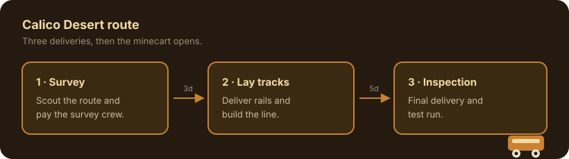

---
title: Desert Minecart
description: The Calico Desert route, its three unlock stages, and how to move the arrival point.
order: 21
---



The Desert route connects the minecart network to Calico Desert. It is the longest build in the mod:
survey the route, lay the tracks, then pass the final inspection. Each stage is its own delivery, so
you never pay the whole cost up front.

The values below follow the site's mode switch.

## Requirements

{{requirements:Desert}}

After the survey, the tracks stage is available after
{{spot.Desert.Unlock.Steps[1].WaitDays}} days. The inspection follows
{{spot.Desert.Unlock.Steps[2].WaitDays}} days after the tracks are laid. Waiting is measured in
in-game days and is checked when you talk to the crew.

## Configure the arrival point

The default drop-off is tile {{spot.Desert.TargetTile.X}}, {{spot.Desert.TargetTile.Y}} facing
{{spot.Desert.TargetDirection}}. Override it per player in `config.json`:

```json
{
	"SpotPositions": {
		"Desert": { "X": 32, "Y": 40, "Direction": "down" }
	}
}
```

Only the fields you set are overridden; everything else keeps the asset defaults. See
[Configuration](/mods/immersive-minecarts/configuration/) for the full option list.

## Unlocking it for testing

With `EnableDebugCommands` on (default `{{config.EnableDebugCommands}}`):

- `imm_unlock Desert` pays the next stage normally.
- `imm_unlock Desert force` advances one stage without requirements.
- `imm_lock Desert` clears the route and its progress.

## See also

- [Destinations](/mods/immersive-minecarts/destinations/)
- [Progression](/mods/immersive-minecarts/progression/)
- [Configuration](/mods/immersive-minecarts/configuration/)
- [Calico Desert](https://stardewvalleywiki.com/Calico_Desert)
